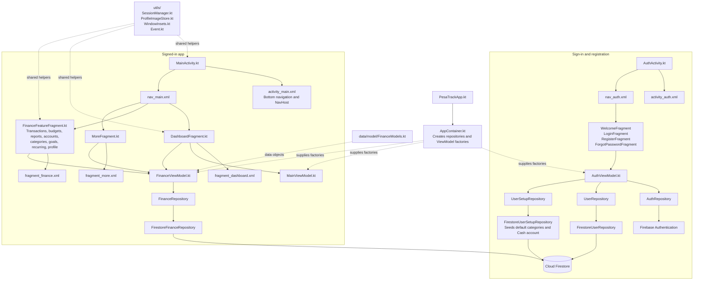

# PesaTrack Expense Tracker

Android expense-tracking app built with Kotlin, XML layouts, Firebase Authentication, and Cloud Firestore.

## How the app files connect

This diagram shows the main path from app startup and screens to the view models, repositories, and Firebase. The XML layouts provide the screen views; the Kotlin activities and fragments control them.

### Where to start reading

| If you are changing… | Start with… | Also check… |
| --- | --- | --- |
| App startup or dependency wiring | `PesaTrackApp.kt`, `AppContainer.kt` | `MainActivity.kt`, `AuthActivity.kt` |
| A screen’s appearance | `app/src/main/res/layout/` | The matching Kotlin Fragment and `values/` resources |
| Navigation | `app/src/main/res/navigation/` | `MainActivity.kt` |
| Sign-in or registration | `ui/auth/` | `data/repository/AuthRepository.kt`, `AuthViewModel.kt` |
| Transactions, budgets, or accounts | `ui/main/FinanceFeatureFragment.kt` | `FinanceViewModel.kt`, `data/repository/FinanceRepository.kt`, `FinanceModels.kt` |
| Firebase data behavior | `data/repository/` | Matching view model and `AppContainer.kt` |
| Shared app behavior | `utils/` | Activities or fragments that use the helper |

## Team workflow and change rules

These rules apply to every contributor. Ask the team leader before making a change when its scope or impact is unclear.

1. **Agree on the task first.** Tell the team what you plan to change, which files or feature it affects, and when you expect to finish.
2. **Use a separate branch for each task.** Do not commit work directly to `main`. Use a pull request so the team can review changes before they are merged.
3. **Keep each change focused.** Edit only the files needed for your task. Do not move folders, rename packages, change the app architecture, or remove existing features without approval.
4. **Do not change project configuration without the team leader’s approval.** This includes Gradle files and versions, the Gradle wrapper, Android Gradle Plugin, Kotlin plugin, dependency versions, SDK settings, package/application ID, Firebase configuration, and build settings. A feature or screen task is not a reason to change configuration.
5. **Protect Firebase setup.** Do not replace `google-services.json`, change Firebase project settings, or alter Firestore rules without approval and coordination with the team leader.
6. **Preserve code-to-layout connections.** When editing XML layouts, keep view IDs used by Kotlin code. Before removing or renaming an ID, find its references and agree on the change with the team leader.
7. **Check resources used by your changes.** Confirm referenced strings, colors, styles, icons, and drawables exist. Prefer the project’s existing styles and resources.
8. **Build after changes.** Before opening a pull request, build the app and fix errors caused by your changes. Include the build result in the pull request description.
9. **Review your own changes.** Check the complete diff. It should contain only the intended work, with no secrets, generated build output, local machine settings, or unrelated edits.
10. **Make commits understandable.** Use short messages that explain the change, for example: `Improve login screen styling`.
11. **Make pull requests reviewable.** Explain what changed and why, list affected areas, and include screenshots for UI changes. Wait for approval before merging.
12. **Do not force-push shared branches or bypass branch protection.** If a push is rejected because the branch is behind or protected, stop and use the team’s pull request process. Never overwrite `main` to get around a rejection.
13. **Handle conflicts carefully.** Read both versions before choosing “Yours” or “Theirs”; those labels depend on whether you are merging or rebasing. Keep needed work from both sides, and ask for help if unsure. Do not discard a teammate’s changes just to clear a conflict.
14. **Communicate blockers early.** Share the exact error, the command or action that caused it, and what you have tried. Do not make unrelated configuration changes as a workaround.

## Before opening a pull request

- [ ] I worked on a task branch and did not commit directly to `main`.
- [ ] I kept the change within the agreed scope.
- [ ] I did not change project configuration, Gradle versions, package ID, or Firebase setup without approval.
- [ ] I checked the diff for unrelated files, secrets, and generated output.
- [ ] I built the app and recorded the result.
- [ ] I described the change and added screenshots for UI updates.
